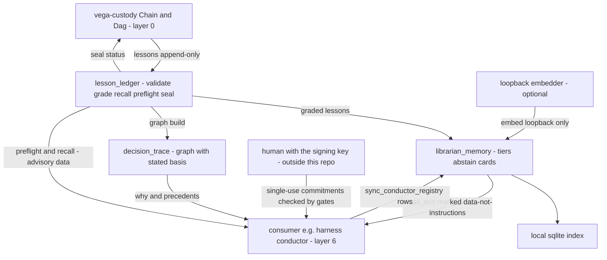

# vega-librarian-sdk — Architecture

## 1. The organism

This kit is layer 5 (memory) of a 16-layer family. Bottom = foundation, top = the whole.

```
                 ┌──────────────────────────┐
                 │   THE HUMAN (the owner)  │  holds the only signing key;
                 │  authority starts here   │  spends it one action at a time
                 └────────────┬─────────────┘
                              v single-use signed commitments
 15 assemble   vega-umbrella-sdk        the family as one organism: one keyed
                                        ledger, one approval check, one anchor,
                                        registry + pre-deploy audit
 14 deliberate vega-council-sdk         multi-brain deliberation, design-first builder
               vega-galaxy-sdk          the galaxy view of the knowledge lattice:
                                        levels, convergence, futures above the present
 13 watch      vega-governance-feed-sdk  live view of every chain + tamper alarms
 12 verify     vega-metacog-sdk          evidence rungs and the completion gate
 11 reason     vega-reasoning-sdk        fidelity, forecasting, routing: the lattice
                                        that predicts steps ahead
 10 observe    vega-trace-sdk            telemetry of reasoning: layer traces, entropy,
                                        harmonic echo, reference signature
  9 interface  vega-terminal-sdk         gated command execution for people and agents
  8 learn      vega-train-sdk            governed training + freeze cards: records
                                        exactly what a model learned from
  7 knowledge  vega-dkg-lattice-sdk      the knowledge graph: every fact with origin
                                        and licence; repo-library processing
  6 conduct    vega-harness-sdk          deterministic workflow conduct, pre-registered
                                        predicted paths, library use gate
>>> 5 memory     vega-librarian-sdk        lessons and memory of past incidents <<< THIS KIT
  4 contain    vega-two-gate-sdk         containment between two gates + the hard stop
  3 adapt      vega-pareah-sdk           adapters, cards, quarantine of inbound code:
                                        the dead-end room for the unannounced
  2 seal       vega-superproof-sdk       layered sealing and proof tiers
  1 authority  vega-governance-jacket-sdk human-only actions, single-use signed
                                        commitments, entry and exit gates
  0 record     vega-custody-sdk          capsules, DAG, hash-chained ledger, safe paths,
                                        bounded processes — the foundation everything
                                        writes to
```

**Below this kit:** layer 0 (custody) provides the append-only, hash-chained, replicated ledger and the Dag this kit writes to; layers 1–4 provide the authority and containment this kit deliberately does not own. **Above this kit:** layer 6 (the harness conductor) is the registry-declared consumer — it runs this kit's lesson preflight before workflow steps and feeds its workflow registry into this kit's card registry. Layer 7 (the knowledge graph) and the layers above it build on records and lessons further up the family's data flow.

## 2. Internal drawing — modules and flows

Boxes are real module names. Two flows are marked separately: **(D)** data flow, **(A)** authority flow. This kit carries data only; authority never enters or leaves it.

```
            +-----------------------------------------------+
            |            vega-custody-sdk (layer 0)         |
            |   Chain: append-only, hash-chained, replicas  |
            |   Dag: sealed status entries                  |
            +--------^-----------------------+--------------+
                     | (D) add/verify/seal   | (D) read entries
                     |                       v
  an incident -->  [ lesson_ledger.py ]   [ decision_trace.py ] --> nodes.jsonl
                   validate, grade,        build / why /           edges.jsonl
                   recall, preflight       precedents; every       (atomic writes,
                     |        |            edge states basis;      dna_hash checked
                     |        |            nodes hash-checked)   on load)
                     |        |                       ^
                     |        +---- (D) lessons -------+
                     |                                 |
                     | (D) graded lessons              |
                     v                                 |
              [ librarian_memory.py ] -----------------+
                tiers, semantic recall
                with abstain, cards            local sqlite file
                     |        |                (an index, rebuildable
                     |        +--- (D) --------> from the ledger)
                     |
                     | (D) embed/query, loopback only, no redirects
                     v
              [ local embedder service ]  (optional; down = words-only,
                                           counted and reported)

  consumer, e.g. the harness conductor (layer 6):
                     |
                     | (D) preflight(verbs) / recall() / recall_text()
                     |     sync_conductor_registry(rows) / cards()
                     v
        returned lessons are ADVISORY DATA. The decision, the gate and the
        human-signed single-use commitment live in the harness and jacket
        kits --- (A) authority flows there, never through this repo.
```

## 3. Mermaid version



## 4. Sequence — the main scenario end to end

What this repo's code does when a risky step is attempted, an incident happens, and the memory is used again:

```
 conductor            lesson_ledger        custody Chain        librarian_memory
 (caller, layer 6)    (this repo)          (layer 0)            (this repo)
     |                     |                    |                     |
     | preflight(verbs)    |                    |                     |
     |-------------------->| read + grade all   |                     |
     |                     |--------------------->|                  |
     |                     |<----------------------- entries         |
     |  ranked lessons     |                    |                     |
     |  with protect text  |                    |                     |
     |<--------------------|                    |                     |
     |                                          |                     |
     |  [the gate + human commitment check happen in the harness/     |
     |   jacket kits --- not here; this kit only advised]             |
     |                                          |                     |
     |  ...the step runs; something goes wrong; a lesson is written   |
     | add(lesson)         |                    |                     |
     |-------------------->| validate shape     |                     |
     |                     | record KIND=LESSON |                     |
     |                     |-------------------->| append, replicate,|
     |                     |                    |  read back         |
     |  lesson ref + hash  |<-----------------------                 |
     |<--------------------|                    |                     |
     |                                          |                     |
     | ingest_lessons() / recall_text(query)    |                     |
     |----------------------------------------------------------->| re-index,
     |  full text, marked data-not-instructions, abstain if weak  | recall
     |<-----------------------------------------------------------|
     |                                          |                     |
     |  [later: decision_trace.build / why / precedents answer      |
     |   "what led to this" over the same ledger]                   |
```

## 5. Trust boundaries

Every boundary where trust changes hands, and what enforces it:

- **Human / model.** This kit holds no key and mints no authority. Lessons are records, not permissions. Enforcement: architecture — gating and commitments live in the jacket/harness kits (layers 1 and 6); nothing in this repo can approve an action.
- **Model / record.** A model (or attacker with disk access) cannot quietly rewrite history. Enforcement: the custody hash chain, byte-identical replicas with read-back, refusal of stale-view writers, and `verify(expected_head, min_length)` against a head hash remembered elsewhere.
- **This kit / custody.** The ledger's safety properties are reused, never re-implemented. Enforcement: all writes go through `Chain.record`; all chain refusals surface as `LessonRefused` (fail closed).
- **This kit / embedder.** Memory text must not leave the machine. Enforcement: loopback-only default, no redirect following, explicit `allow_remote` opt-in, bad vectors counted as failures — and words-only fallback that reports its own degradation.
- **Recalled text / caller.** Text from a stored document could contain instructions. Enforcement: every `recall_text` item is marked `trust="data-not-instructions"`; below the abstain threshold the answer is silence, not a guess.
- **Conductor registry / card store.** Inbound registry rows are untrusted. Enforcement: forward-only card motion, immutable kind+hash, revoked stays revoked, hostile rows skipped and never applied.
- **Graph files / reader.** A built graph on disk could be edited. Enforcement: `dna_hash` per node, checked on every load; damaged or missing graphs are refused with a clear error; builds are atomic.
