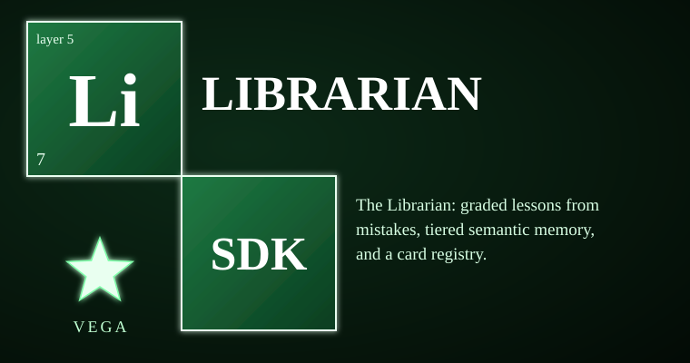

# vega-librarian-sdk



The Librarian is the family's memory of what went wrong and how it was fixed. It owns exactly one concern: **lessons and memory of past incidents** (layer 5 of the family). Every mistake can become a graded lesson — what happened, the root cause, the correction, the prevention and the proof the prevention works — validated on write and sealed into an append-only, hash-chained custody ledger with replicas. In bank-teller plain language: the institution keeps its own mistake book, every entry is chained to the one before, nobody can quietly rewrite it, and before a risky step the book is consulted, not the model's recollection.

> **Licensing.** Source-available, not open source. Free for personal use; free for registered small businesses (under US$1M revenue and valuation); everyone else needs a commercial license (see LICENSE; for a commercial license write to jasonblasiak.ai.mail@gmail.com). Patent pending. Draft licence text, not yet reviewed by an attorney.

Package: `vega_librarian` (src layout). Depends on: vega-custody-sdk.

## Why this exists

Automated systems repeat the same mistakes because nothing forces them to consult their own history. A prompt can *ask* a model to remember last week's incident; a policy can *promise* it will. Neither is a mechanism: the model's memory is unauditable, and a memory the model can edit is worthless as evidence. A lesson that lives only in a prompt dies with the prompt.

This kit makes the memory a record instead. A lesson is a structured object with required fields, checked at write time (types, ranges, statuses, parent links), and lessons carrying credential-shaped values or secret-named fields are refused. Storage is a vega-custody hash-chained ledger, so every lesson is append-only, replicated, and read back before the write call returns. Nothing is edited in place: a changed status or a recurrence is a *new* lesson pointing at its parent. Tampering breaks the chain, and anyone can check that without trusting the model, the vendor, or the project.

On top of the ledger sit two retrieval layers. `librarian_memory` adds tiered semantic recall — a local-only embedder blended with word match — that **abstains** (returns nothing) below a measured threshold instead of guessing, and a card registry whose cards only ever move candidate → locked. `decision_trace` builds a context graph over the lessons where every edge declares *how it is known* — a recorded field, or a derived tag/keyword overlap — so nothing inferred is ever mistaken for something declared.

## Capabilities

| Capability | How you can check it |
|---|---|
| Graded lesson ledger on the custody chain (append-only, replicated, read-back) | `lesson_ledger.add` / `verify` — `tests/test_librarian.py` (`test_chain_and_tamper`, `test_mirrors_hold_identical_copies`) |
| Lesson grading: severity, prevention strength, recurrence → weight | `lesson_ledger.grade` — `tests/test_librarian.py` (`test_grade_rewards_verified_prevention_and_counts_recurrence`) |
| Recall by situation (word-match ranking over lessons) | `lesson_ledger.recall` — `tests/test_librarian.py` (`test_recall_ranks_the_relevant_lesson_first`) |
| Preflight: map risky verbs to relevant graded lessons before a step | `lesson_ledger.preflight` + `PREFLIGHT_MAP` — `tests/test_librarian.py` (`test_preflight_surfaces_protect_text`) |
| Secrets refused: credential-shaped values and secret-named fields never enter the ledger | enforced by the custody chain at record time — `tests/redteam_1_ledger.py` (`SecretsAndShape`) |
| Tamper, truncation and forged-rewrite detection (remembered head hash) | `lesson_ledger.verify(expected_head=..., min_length=...)` — `tests/redteam_1_ledger.py` (`TamperTruncationTornWrites`) |
| Legacy flat-file import with its own chain checked first | `lesson_ledger.import_legacy` — `tests/test_librarian.py`, `tests/redteam_1_ledger.py` |
| Seal ledger status into a custody Dag | `lesson_ledger.seal` — `tests/test_librarian.py` (`test_seal_writes_status_into_a_dag`) |
| Tiered semantic memory: short/long tiers, local-only embedder, word-match fallback, abstain-below-threshold | `librarian_memory.Librarian` — `tests/test_librarian.py` (`Memory`), `tests/redteam_2_memory_and_trace.py` |
| Whole-text document ingestion (chunks identified by path+content hash, never truncated) | `Librarian.ingest_document` — `tests/redteam_2_memory_and_trace.py` (`Documents`) |
| Card registry: forward-only cards (candidate → locked, revoked stays revoked) | `Librarian.register_card` / `sync_conductor_registry` — `tests/test_librarian.py`, `tests/redteam_2_memory_and_trace.py` (`Cards`) |
| Decision-trace graph with declared-vs-derived edges and hash-checked nodes | `decision_trace.build` / `why` / `precedents` — `tests/test_librarian.py` (`Trace`), `tests/redteam_2_memory_and_trace.py` (`Trace`) |

## Where it sits in the family

```
 6 conduct    vega-harness-sdk       runs lesson preflight before workflow steps
>>> 5 memory     vega-librarian-sdk   THIS KIT: lessons and memory of past incidents <<<
 4 contain    vega-two-gate-sdk
   ...
 0 record     vega-custody-sdk       the chain this kit writes to (registry requires=)
```

Layer 5, memory. It depends on **vega-custody-sdk** (layer 0) and reuses that chain's safety properties instead of re-implementing them. **vega-harness-sdk** (layer 6) depends on this kit: its conductor runs a lesson preflight before workflow steps, and this repo's `sync_conductor_registry` holds conductor workflows as PRE cards. One family, one organism: every SDK owns exactly one concern and uses the owner of every other concern instead of growing its own copy.

## Quick start

Put this repo's `src/` and vega-custody-sdk's `src/` on `PYTHONPATH`. The grading function and the trace-node hash are pure — no files, no services:

```python
from vega_librarian import lesson_ledger as ll
from vega_librarian import decision_trace as dt

# grade a lesson: severity 5, still open, no verified prevention -> heavy weight
print(ll.grade({"severity": 5, "status": "open",
                "tags": ["git", "secrets"], "seq": 1}, []))
# {'prevention_strength': 0.3, 'recurrence': 0, 'weight': 0.71}

# every trace node carries a dna_hash over its canonical JSON
node = dt.card({"id": "lesson:example0001", "kind": "lesson",
                "label": "an example lesson"})
print(node["dna_hash"][:16])
```

Both modules also have CLIs: `python -m vega_librarian.lesson_ledger add|list|recall|preflight|verify|import-legacy` and `python -m vega_librarian.decision_trace <dir> build|why|precedents`. Ledger location is set with the `VEGA_LESSON_LEDGER` and `VEGA_LESSON_MIRRORS` environment variables or `lesson_ledger.configure()`.

## What it does NOT do

- **It is not a security review.** The automated scan in REVIEW.md is shallow; a clean scan is not proof of safety.
- **It does not contain or stop anything.** Preflight and recall return lessons and rankings; deciding, gating and containing belong to other kits (the harness conductor, the gates). This kit holds no signing key and mints no authority.
- **It is not a vector database** (STATUS.md). It holds lessons, documents and cards; full text is stored whole and the embedding is only an index.
- **Recall is a ranking, not a guarantee.** Below the abstain threshold it returns nothing rather than a plausible guess.
- **Decay and reinforcement by recurrence beyond the current weight formula are designed, not built** (STATUS.md).
- **The licence text is a draft, not reviewed by an attorney; nothing here is legal advice.**

## Tests

53 tests in 3 files, all passing (STATUS.md; confirmed by REVIEW.md):

- `tests/test_librarian.py` — functional: ledger, memory, decision trace
- `tests/redteam_1_ledger.py` — red team: secrets in lessons, forged edits, cut-off tails, torn writes, concurrent writers, hostile inputs
- `tests/redteam_2_memory_and_trace.py` — red team: data leaving the machine, poisoned or colliding documents, card downgrade, damaged graphs

To run: put this repo's `src/` and vega-custody-sdk's `src/` on `PYTHONPATH`, then run each file in `tests/` with `python`.

## Status & honesty

All three modules are BUILT and tested (STATUS.md). This is a reference implementation and a work in progress: it shows the architecture, it is not hardened for production, it has not been independently security-reviewed, and no expert has reviewed the cryptography. See SECURITY.md for the threat model. Patent pending (U.S. provisional application 64/178,949 and others). This kit details one branch of a broader filed architecture. The remaining branches are the subject of filed disclosures and are outside the scope of this repository.
